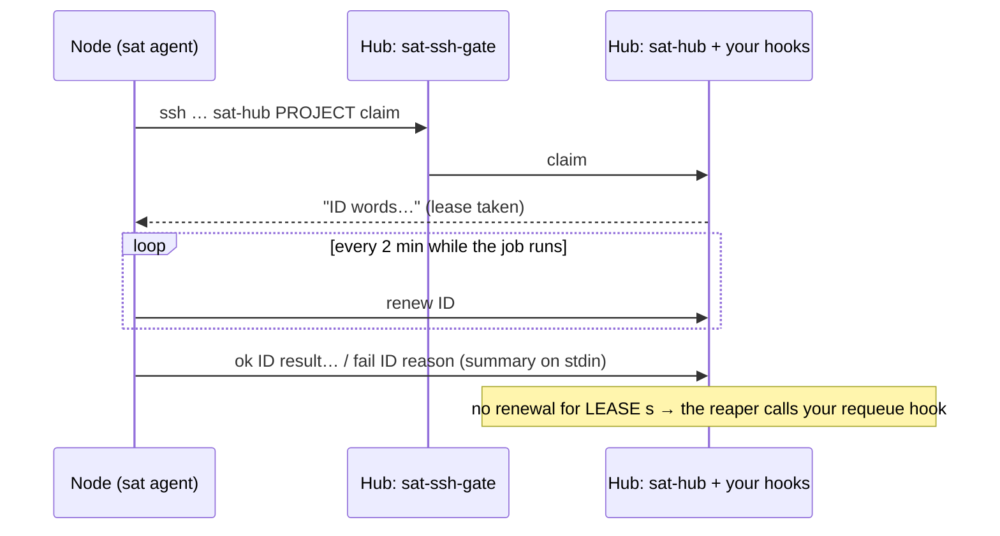

# satellite

> [!WARNING]
> **This project was built by AI.** Satellite's code, tests and documentation were written by AI
> agents (Claude Opus 5.5) directed by RashKash103, and have not been fully reviewed by a human.
> It is young: its tests run on one machine, and it has not yet run across two. It runs commands on
> your machines and opens an SSH entry point on the hub: read [docs/security.md](docs/security.md)
> before you use it, and don't use it anywhere a mistake would be costly without checking it
> yourself.

**Lend a second machine's CPU to a build pipeline for as long as it happens to be on.**


You have one machine that runs a queue of work: builds, test runs, checks. You have another, often
faster, machine that is only switched on part of the day. Satellite lets the second machine take
jobs from the first while it is on, and lets it disappear at any moment without anything waiting
for it.

- **Pull, not push.** Nodes ask the hub for work over SSH. The hub never connects to a node, so a
  node can sit behind NAT, sleep, or be switched off.
- **Leases.** A node renews each job's lease every 2 minutes. A job whose node goes quiet goes back
  to the hub's own queue after `LEASE` seconds (10 minutes by default).
- **Any project.** The engine knows nothing about your work. A project plugs in with one hooks
  script on the hub and a few files the hub hands to nodes.
- **Locked-down keys.** A node's key can only reach what its project file allows: fetch named git
  repositories, push under one ref prefix, copy named directories out, and talk to the lease engine.
- **Easy on and off.** `sat start`, `sat drain` (finish what's running, then stop), `sat stop`,
  `sat autostart on|off`. A node is a systemd user service, and `sat` alone is a live view of its
  lanes, their jobs and progress.
- **Scheduled drains.** `sat PROJECT schedule end 19:00 daily` has the node stopped by 19:00
  every day: it stops taking jobs once a typical one (the p80 of its recent jobs) would no longer
  finish in time. `start 18:00` drains from a time instead; once or daily, set from the command
  line or the live view (`D`), and kept by the service itself.
- **Awake while working.** While any lane runs a job, the node holds a logind inhibitor, so it does
  not suspend mid-job (`KEEP_AWAKE=off` lets it sleep); the lock goes with the last job.
- **Views and alerts.** A project can bring its own views of its work (a queue, a lane's steps,
  charts), shown by `sat PROJECT view NAME` and as tabs in the live view. The node raises alerts
  when a lane stalls, the hub goes quiet or the disk fills, and can send a desktop notification.
- **One binary on the node.** `sat`, a static Go binary, with nothing else to install. It updates
  itself only when you ask (from this repository's releases, checksummed and attested), and
  `sat uninstall` takes it all away again.
- **Installs nothing behind your back.** Setup checks the node and lists what's missing with the
  commands to install it. `--install` runs them only after showing each one (apt changes
  simulated, never removing a package) and asking.
- **Minds the disk.** A node keeps 20 GB or 10 % of its disk free (whichever is more), asks the
  project to clean up when it runs low, and stops taking work rather than fill the disk.
- **Plain bash on the hub.** No daemon to install beyond a one-minute reaper, and no database:
  leases are files.

## How it works



More in [docs/how-it-works.md](docs/how-it-works.md).

## Quick start

On the **hub** (the machine that owns the work):

```sh
git clone https://github.com/RashKash103/satellite ~/satellite
~/satellite/hub/install                       # links the hub commands, installs the reaper unit
systemctl --user enable --now sat-reaper
cp ~/satellite/examples/hello/project ~/.config/sat/projects/hello   # edit HOOKS if the checkout is elsewhere
```

The hub also needs `sshd`, with key-only logins ([docs/hub.md](docs/hub.md)).

On the **node** (the part-time machine), once it can already log in to the hub with an SSH key,
get the binary ([docs/node.md](docs/node.md#2-get-the-binary) has the checksum and attestation
checks) and let it set itself up:

```sh
arch=$(uname -m | sed 's/x86_64/amd64/; s/aarch64/arm64/')
curl -fsSLO https://github.com/RashKash103/satellite/releases/latest/download/sat_linux_$arch
chmod +x sat_linux_$arch && ./sat_linux_$arch setup HUB_IP hello HUB_USER   # installs itself in ~/.sat/bin
sat hello check          # what's missing, if anything, and how to install it
sat hello selftest
sat hello start
sat                      # the live view
sat completion install   # optional: zsh completion (prints the line for ~/.zshrc)
```

(or `go install github.com/RashKash103/satellite/cmd/sat@latest` and `sat setup ...`). A node set
up with the earlier bash scripts moves over with `sat migrate`.

Then give the hub some work and watch it come back:

```sh
mkdir -p ~/.local/share/sat-hello/queue && echo 2000000 > ~/.local/share/sat-hello/queue/job1   # on the hub
sat hello logs                                          # on the node, or just: sat
cat ~/.local/share/sat-hello/done/job1                  # on the hub
```

## Documentation

| | |
|---|---|
| [How it works](docs/how-it-works.md) | roles, the lease lifecycle, what happens when a node vanishes |
| [Hub setup](docs/hub.md) | install, project files, sshd, the reaper, watching it |
| [Node setup and control](docs/node.md) | key login, the binary, `sat setup`, the `sat` command and live view, node config, alerts, updates, uninstall, migrating |
| [Writing a project](docs/projects.md) | the hooks contract, the bundle, the job environment, views, a walkthrough of `examples/hello` |
| [Lessons from the first project](docs/lessons.md) | the gotchas: sharing a queue with the hub's workers, claim filters, trusting a node's results, tools that install on first use, coding agents on a node, disk and paths |
| [Security](docs/security.md) | what a node key can and can't do, and what you are trusting |
| [Testing](docs/testing.md) | the end-to-end test, and testing your own project without a second machine |
| [Roadmap](ROADMAP.md) | what is done of the Go port, and what is next |

## Requirements

- **Hub:** Linux, bash 4.4+, coreutils, `tar`, `gzip`, an SSH server, `flock` (util-linux), and
  `git` and `rsync` if your projects use them.
- **Node:** Linux (amd64 or arm64), bash (jobs run through it), an OpenSSH client, and systemd with
  user services (and `loginctl enable-linger` so the service runs without a login session). The
  legacy bash node also needs coreutils, `tar`, `gzip`, `setsid` and `diff`.

## Layout

```
hub/install          set a machine up as a hub
hub/sat-hub          lease engine: claim, renew, ok, fail, release, get/put, bundle, status, nodes, --reap
hub/sat-ssh-gate     forced command for node keys
hub/sat-reaper       reaps silent leases every minute (hub/sat-reaper.service runs it)
hub/pre-receive      git hook: pushes through the gate may write only the project's PUSH_PREFIX
cmd/sat/             the node: one binary (agent, control command, live view, sat-call for jobs)
internal/            its packages: agent, hub (SSH), bundle, plan (requirements), view, tui, selfupdate, cli
e2e/                 end-to-end test of the Go node against the bash hub
node/                the legacy bash node (sat-setup, sat-agent, sat, sat-call, sat-lib, sat@.service)
examples/hello/      a complete small project
test/run             end-to-end test on one machine
```

## Contributing

Issues and pull requests are welcome. Run `go vet ./...`, `go test ./...`, `test/run` and
[ShellCheck](https://www.shellcheck.net/) before you send a change; CI runs them all.

## License

[MIT](LICENSE).
